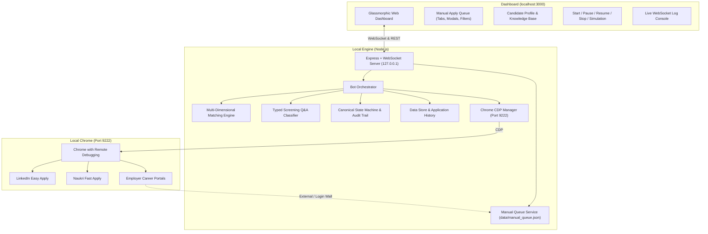

# ⚡ AutoApply AI Agent - Local Job Automation & Screening Suite

An autonomous, local-first AI job-application and opportunity-management platform. It combines automated job discovery across **LinkedIn**, **Naukri**, and **Foundit** with a dedicated **High-Match Manual Application Queue** for external employer career portals, a multi-dimensional job matching engine, a strongly-typed screening question classifier, and a canonical state machine.

---

## 🎯 Key Capabilities & Architecture

- **100% Local-First & Security-Hardened**:
  - Bound strictly to loopback (`127.0.0.1:3000`).
  - CORS restricted to loopback and localhost origins.
  - JSON payload size caps (1MB) and URL scheme validation (rejects `javascript:`, `file:`, `data:`).
  - Secret scrubbing: Gemini API keys are redacted (`AIzaSy...`) in all API responses and WebSocket logs.
- **Dedicated High-Match Manual Apply Queue**:
  - **Core Guarantee**: Every worthwhile discovered job remains accessible, even when automatic submission is unavailable.
  - Preserves external career sites (Workday, Taleo, iCIMS, SuccessFactors), login walls, complex multi-step forms, and verification challenges.
  - Direct job-listing URLs and confirmed application links with normalized tracking parameter deduplication.
  - Interactive actions: *Apply on Company Website*, *Mark as Applied* (with confirmation ID, date, and self-reported audit trail), *Notes*, and *Dismiss*.
- **Canonical Candidate Profile & Conflict Detection**:
  - Typed candidate schema with version history and field verification status.
  - Strict separation of **Total Experience** (2.7 years) from technology-specific experience.
  - Strict separation of **Official Notice Period** (90 days) from **Negotiable Notice Period** (45 days).
  - Strict separation of **Current CTC** (₹3.80 LPA) from **Expected CTC** (₹10.00 LPA).
  - Automated conflict detection flagging discrepancies against verified baselines.
- **Strongly-Typed Screening Q&A Classification**:
  - Semantic intent classification preventing cross-field bleeding (e.g. Email is evaluated strictly before Residential Address).
  - Unlisted technology experience defaults to strictly `0` years to prevent hallucinated candidate claims.
  - Consequential legal, criminal, and compliance questions are flagged for explicit human review.
  - Option matching for dropdowns/radios without blind first-item picking.
- **Multi-Dimensional Job Matching & Experience Compatibility**:
  - Calibrated scoring: Core Technical (30%), Experience/Seniority (25%), Role Relevance (20%), Mandatory (10%), Location/Work Mode (10%), Preferences (5%).
  - Explicit experience compatibility categories: `meets_required`, `compatible_adjacent`, `below_preferred`, `below_mandatory`, `requirement_unclear`, `experience_not_specified`.
  - Anti-inflation guardrails: Senior roles (8-12 years) are capped at ≤ 60% for a 2.7-year candidate rather than naive 98% matches.
- **Canonical Job & Application State Machine**:
  - Explicit lifecycle states: `DISCOVERED`, `EVALUATED`, `SKIPPED_LOW_MATCH`, `INELIGIBLE`, `READY_FOR_AUTO_APPLY`, `AUTO_APPLY_IN_PROGRESS`, `MANUAL_ACTION_REQUIRED`, `READY_TO_SUBMIT`, `SUBMITTED_UNVERIFIED`, `APPLIED_CONFIRMED`, `ALREADY_APPLIED`, `CLOSED_OR_EXPIRED`, `FAILED_RETRYABLE`, `FAILED_FINAL`.
  - Legal transition enforcement and timestamped audit trails.
  - Fixes historical stats: `already_applied` and `closed` jobs are no longer erroneously counted as successful applications.
- **Automated Native Test Suite**:
  - Built on Node.js native test runner (`node --test`) covering profile validation, screening intent resolution, calibrated matching, state machine transitions, manual queue operations, security hardening, and end-to-end acceptance scenarios.

---

## 🏗️ Architecture Blueprint



---

## 🚀 How to Run

### Method 1: One-Click Launch (Windows)
Double-click `start.bat` in the repository root. It will:
1. Start the local server on `http://127.0.0.1:3000`.
2. Automatically open the dashboard in your default browser.

### Method 2: Command Line Startup
```powershell
# Start the local server
npm start
```
Open [http://localhost:3000](http://localhost:3000) in your browser.

---

## 🧪 Running Automated Tests

The application includes 47 automated tests using Node.js's built-in test runner:
```powershell
# Run the complete test suite
npm test
```

### Specific Test Modules:
```powershell
node --test test/profile-manager.test.js     # Profile validation & conflict detection
node --test test/screening-classifier.test.js # Screening Q&A intent classification
node --test test/matching-engine.test.js       # Scoring calibration & experience categories
node --test test/state-machine.test.js         # Legal transitions & legacy mapping
node --test test/manual-queue.test.js          # Queue deduplication, filters & persistence
node --test test/security.test.js              # Secret scrubbing, CORS & URL validation
node --test test/manual-acceptance.test.js    # Phase 15 End-to-end acceptance scenario
```

---

## 🌐 Connecting Chrome for Automation

To allow the agent to use your logged-in LinkedIn and Naukri sessions:
1. Click **"Launch"** next to Chrome Status in the top dashboard header, or execute:
   ```cmd
   launch_chrome_debug.bat
   ```
2. Chrome launches with remote debugging enabled on port `9222`.
3. Log into your accounts (LinkedIn, Naukri, Foundit).
4. Click **"Start AutoApply"** on the dashboard.

---

## 📋 Manual Application Queue Workflow

When an opportunity is discovered that requires human action (such as Workday/Taleo portals, CAPTCHA, complex multi-step forms, or sensitive screening questions):
1. The job is automatically saved and prioritized in the **Manual Apply Queue**.
2. Click the **"Manual Apply Queue"** tab in the dashboard navigation.
3. Click **"Apply on Website"** to open the genuine listing or direct application page in a new secure tab.
4. After completing the application, click **"Mark Applied"** to enter the optional Confirmation ID, application date, and notes.
5. The job state updates to `APPLIED_CONFIRMED` with an auditable transition log, preserving accurate statistics across server restarts.

---

## 🔒 Security & Data Integrity

- **Safe Backups**: Backups of all historical applications and configurations are maintained in `data/*.backup.json` and `config/*.backup.json`.
- **Deduplication**: Job URLs are canonicalized by stripping ephemeral tracking tags (`utm_*`, `refId`, `session`, `trackingId`) while preserving unique job IDs.
- **Local Isolation**: No external analytics, telemetry, or cloud databases are used.
